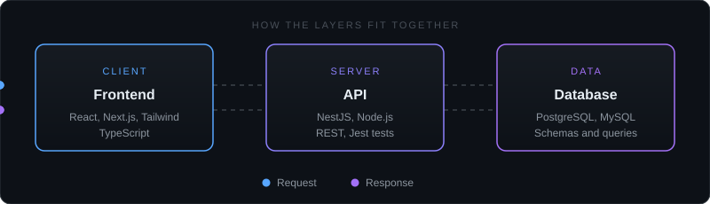
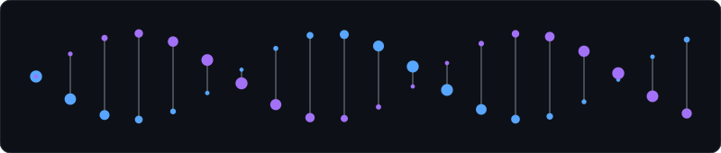

  

<h2 align="center">&nbsp;About Me</h2>

 

I am a final-year BSc Computer Science student at the **University of Pretoria**, graduating in mid-2027. I matriculated in 2021 with **4 distinctions**, and I began university in Biological Sciences before moving into Computer Science. That background is why I am curious about how software can support biology and health, although my project work so far has been in web development.

My strongest link is to **UI engineering**: I enjoy turning designs into clear, responsive interfaces, and I work across the stack with APIs and databases to support them. I am looking for a **graduate developer role in South Africa** where I can ship real software, learn from experienced engineers, and in time explore **Bioinformatics and BioTech**, an interest I have not yet applied in a project.

<h2 align="center">&nbsp;At a Glance</h2>

| | |
|:--|:--|
| &nbsp;**Education** | BSc Computer Science, University of Pretoria (2027) |
| &nbsp;**Focus** | UI engineering, full-stack development, APIs |
| &nbsp;**Interested in** | Bioinformatics and BioTech, as a future direction |
| &nbsp;**Languages** | English, Afrikaans, Setswana, Sesotho, Sepedi |
| &nbsp;**Status** | Open to graduate developer opportunities |

<h2 align="center">&nbsp;My Path</h2>

<h2 align="center">&nbsp;What I Bring</h2>

<table>
  <tr>
    <td align="center" width="25%">
        
      <b>UI Engineering</b> 
      Responsive interfaces with React, Next.js and Tailwind, designed in Figma
    </td>
    <td align="center" width="25%">
        
      <b>Backend Development</b> 
      REST APIs and services with NestJS and Node.js
    </td>
    <td align="center" width="25%">
        
      <b>Database Design</b> 
      Schemas and queries in PostgreSQL and MySQL
    </td>
    <td align="center" width="25%">
        
      <b>Team Delivery</b> 
      Collaborative development with Git and GitHub
    </td>
  </tr>
</table>

 

<h2 align="center">&nbsp;Featured Project</h2>

**Uni Textbook Marketplace** is my capstone project for the University of Pretoria's Software Engineering module (COS301). It is a team-built platform that helps university students buy and sell textbooks. I serve as project manager, UI engineer and DevOps engineer on the team.

<h2 align="center">&nbsp;Tech Stack</h2>

### Languages

### Frontend

### Backend and Databases

### Tools and Workflow

<h2 align="center">&nbsp;Looking Ahead</h2>

I started in Biological Sciences before moving into software, and over time I would like to bring the two together. I have not built a biology or bioinformatics project yet, so for now this is a direction I am curious about, not experience I can point to. I am keen to begin with small Python projects on biological data.

<h2 align="center">&nbsp;Currently</h2>

  

| | |
|:--|:--|
| &nbsp;**Building** | Uni Textbook Marketplace with my capstone team |
| &nbsp;**Curious about** | Bioinformatics and BioTech, starting with Python for biological data |
| &nbsp;**Looking for** | Graduate developer roles in South Africa |

<h2 align="center">&nbsp;GitHub Stats</h2>

 

 

<h2 align="center">&nbsp;Let's Connect</h2>

I am always happy to talk about software, UI engineering, or opportunities.

